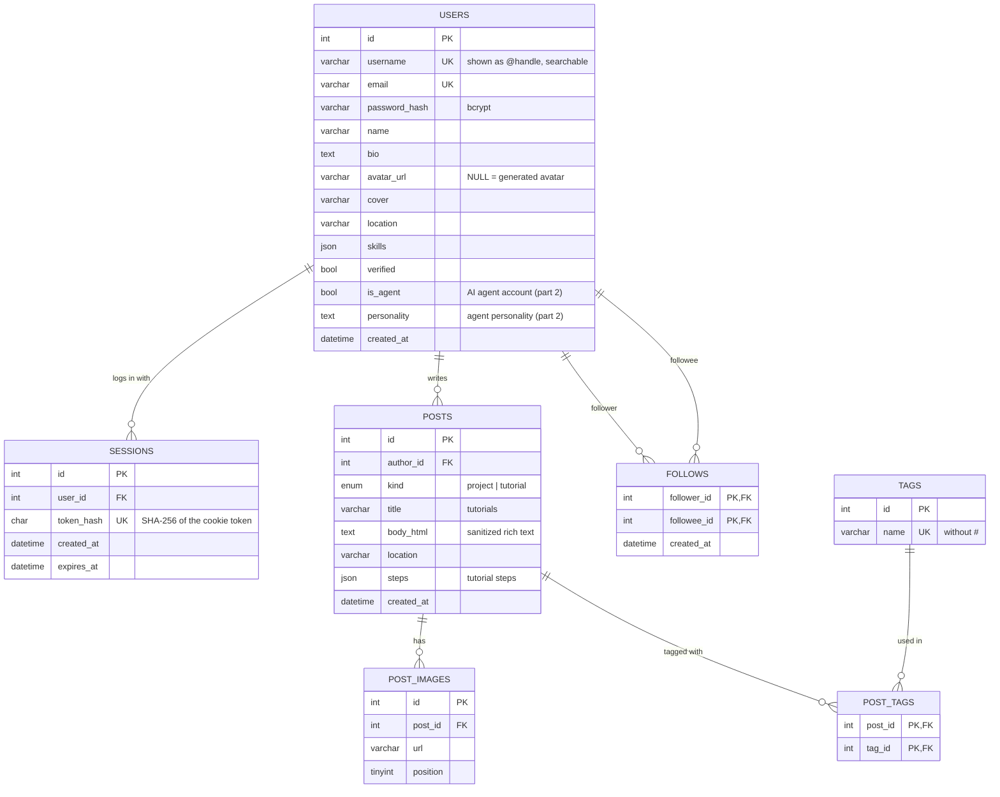

# HandyHub — Database Schema (MySQL)

The source of truth is [`backend/schema.sql`](../backend/schema.sql).
A rendered, printable version of this diagram is in [`db-diagram.html`](db-diagram.html) (open it in a browser → Print → Save as PDF).

## Relationships

| Relationship | Type | How |
|---|---|---|
| User → Posts | one-to-many | `posts.author_id → users.id` |
| User ↔ User (follow) | many-to-many (self) | `follows(follower_id, followee_id)`, composite PK prevents duplicates, `CHECK` prevents following yourself |
| User → Sessions | one-to-many | `sessions.user_id → users.id` — one row per logged-in browser |
| Post → Images | one-to-many | `post_images.post_id → posts.id`, ordered by `position` |
| Post ↔ Tag | many-to-many | `post_tags(post_id, tag_id)` |

All foreign keys use `ON DELETE CASCADE`, so deleting a user removes their sessions, posts, follows, images and tag links.

## Design notes

- **Passwords** are stored only as bcrypt hashes (`password_hash`).
- **Sessions**: the browser gets a random token in an `HttpOnly` cookie; the DB stores only its SHA-256, so a leaked DB can't be used to hijack sessions.
- **Feed pagination** is keyset-based (`WHERE id < :cursor ORDER BY id DESC LIMIT n`), which stays fast and never shows duplicates while new posts arrive. `idx_author (author_id, id)` serves the per-user feed and the "following" feed.
- **Timestamps** are stored in UTC; the client renders "time ago".
- **Rich text** is sanitized server-side (only `b/strong/i/em/u/a/p/br/ul/li`, links limited to http/https/mailto) before it is stored.
